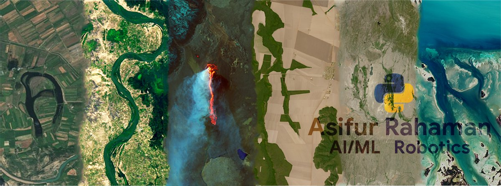

<div align="center">

  

  # ✨ Asifur Rahaman — Modern Developer Portfolio

  **High-Performance Glassmorphic Portfolio for an AI & Machine Learning Developer**

  [](https://asifur-rahaman-portfolio.vercel.app/)
  [](LICENSE)
  [](script.js)
  [](styles.css)
  [](llms.txt)

  <br>

  <p align="center">
    A sleek, ultra-responsive, zero-framework developer portfolio featuring dynamic glassmorphism, animated ambient gradient blobs, interactive image lightboxes, a playable mini-AI game, and seamless theme toggling.
  </p>

  ### 🌐 [Explore the Live Portfolio Here](https://asifur-rahaman-portfolio.vercel.app/)

</div>

---

## ⚡ Highlights & Key Features

- 🔮 **Futuristic Glassmorphic Interface:** Handcrafted backdrop blur (`backdrop-filter: blur(16px)`), subtle translucent borders, and smooth hover interactions built entirely in pure CSS.
- 🎨 **Ambient Liquid Blobs:** Multi-point floating fluid background gradients that smoothly animate across the canvas.
- 🌓 **Dynamic Theme Switching:** Integrated Dark / Light mode toggle with instant transitions and persistent user preference state saved via `localStorage`.
- 🎮 **Interactive "Beat the Mini-AI" Mini-Game:**
  - Built-in Tic-Tac-Toe directly on the page above the footer.
  - **Smart AI:** Unbeatable opponent powered by the Minimax game-tree search algorithm.
  - **Casual Mode:** Relaxed difficulty balancing defensive plays with easy wins.
  - **2-Player Mode:** Pass-and-play for local two-player matches.
  - **Zero Performance Tax:** 0ms idle CPU overhead, no heavy canvas loops, and zero layout shift (CLS = 0).
  - **Agentic & Screen-Reader Accessible:** Structured with WAI-ARIA `role="group"` and explicit coordinate labels (`Square 1 (Top Left)`, `Square 5 (Center)`).
- 🔍 **Click-to-Enlarge Lightbox Modal:** Full-screen responsive lightbox modal for project and award certificate photos, with backdrop blur, image scaling, and `Escape` key listeners.
- 📬 **Asynchronous Contact Form:** Direct serverless email dispatch powered by Web3Forms with bot-check anti-spam traps and user-friendly status indicators.
- ⚡ **Zero-Framework Performance:** 100% vanilla HTML5, CSS3 (Grid & Flexbox), and modern ES6+ JavaScript. No build steps, zero node runtime dependencies, and high Lighthouse scores.
- 🤖 **AI-First & SEO Optimized:** Complete with [`llms.txt`](llms.txt) for LLM search indexing, [`sitemap.xml`](sitemap.xml), [`robots.txt`](robots.txt), and rich OpenGraph social cards.

---

## 🛠️ Tech Stack & Architecture

| Layer | Technologies / Methods |
| :--- | :--- |
| **Markup & Semantics** | HTML5, Semantic Elements, WAI-ARIA 1.2 Attributes |
| **Styling & Effects** | CSS3 (Custom Properties / Variables, CSS Grid, Flexbox, Glassmorphism, Keyframe Animations) |
| **Interactivity** | Vanilla JavaScript (ES6+, DOM Manipulation, IntersectionObserver, Minimax Algorithm) |
| **Forms & Backend** | Web3Forms Asynchronous API |
| **SEO & LLM Discovery** | `llms.txt`, OpenGraph Tags, XML Sitemaps, Schema Standards |
| **Hosting & Deployment** | Vercel Edge Network |

---

## 📂 Project Directory Structure

```text
asifur-rahaman-portfolio/
├── achievements-images/        # High-res award, hackathon, and certificate photos
├── vibecoded-images/           # Project screenshots and software previews (WebP)
├── apple-touch-icon.png        # iOS touch icon
├── asifurimage.webp            # High-priority hero profile portrait
├── favicon.ico / .png / .svg   # Multi-resolution favicons
├── index.html                  # Main portfolio semantic single-page application
├── LICENSE                     # MIT Open Source License
├── llms.txt                    # Standardized structured markdown for LLMs & AI crawlers
├── README.md                   # Project documentation and guide
├── robots.txt                  # Web crawler instructions
├── script.js                   # Client interactivity, theme state, lightbox, & mini-AI game
├── sitemap.xml                 # Canonical XML URL index
├── styles.css                  # Core design system, glass variables, & responsive breakpoints
└── web-banner.jpg              # OpenGraph and README social display banner
```

---

## 🚀 Running & Developing Locally

No Node packages or build compilation steps are required! You can run the portfolio directly with any local static HTTP server:

### Option 1: VS Code Live Server
1. Open the repository folder in **VS Code**.
2. Right-click on [`index.html`](index.html) and select **"Open with Live Server"**.

### Option 2: Python Built-in Server
Open your terminal inside the project directory and run:

```bash
# Python 3
python -m http.server 8000
```
Then visit [`http://localhost:8000`](http://localhost:8000) in your web browser.

---

## 👤 About the Author

**Asifur Rahaman** — AI & ML Developer | Computer Vision & Robotics Enthusiast  
*Kolkata, West Bengal, India*

- 🌐 **Live Portfolio:** [asifur-rahaman-portfolio.vercel.app](https://asifur-rahaman-portfolio.vercel.app/)
- 🐙 **GitHub:** [@asifur8282](https://github.com/asifur8282)
- 💼 **LinkedIn:** [/in/asifur06rahaman](https://linkedin.com/in/asifur06rahaman)
- 📄 **Resume:** [Google Drive Resume](https://drive.google.com/file/d/15oWowPVIAo07UF3ZkDwc-2dcF7dG3gUZ/view?usp=sharing)
- 📧 **Email:** [asifurrahaman2018@gmail.com](mailto:asifurrahaman2018@gmail.com)

---

## ⚖️ License

This project is open-source and available under the [MIT License](LICENSE).
